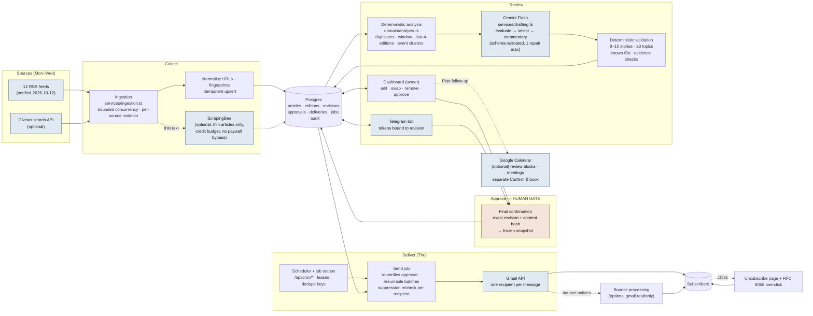
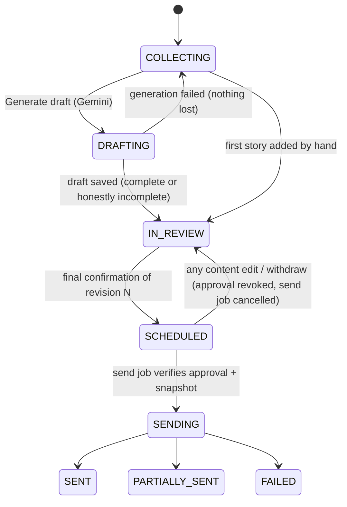

# Components Map — The Dispatch

How data flows from sources to subscribers, where AI is used, where human approval is required, and which steps have external effects.

## External effects and their gates

| Effect | Component | What authorises it | What never authorises it |
|---|---|---|---|
| Email to subscribers | `services/delivery.ts` → Gmail API | A valid, unrevoked final approval of the **current revision** whose frozen snapshot hash matches the content; send time reached (or "Send now" chosen explicitly) | Generated drafts, story approvals, reminders, deadlines passing, calendar events, background jobs |
| Telegram messages to the owner | `services/telegram-bot.ts` | Scheduled draft delivery (Wed 6 PM), the once-per-edition 10 PM reminder, or an owner action | — (only the linked owner chat receives anything) |
| Calendar event / invitations | `services/calendar.ts` | An explicit "Confirm and book" carrying a hash of exactly the reviewed details | Newsletter approval, story approval, AI suggestions |
| Article page fetch | `providers/scrapingbee.ts` | Collection run, thin feed text, within the per-run credit budget | Paywalled hosts (recorded as BLOCKED instead) |
| AI processing | `providers/gemini.ts` | Draft generation, single-story regeneration, meeting agenda suggestion | Article content (treated as untrusted data; cannot trigger tools or sends) |

## State machine (editorial)

An edition enters editorial memory (the "previous four editions" check) as soon as the first recipient's copy is accepted, so a partially sent campaign is never forgotten.

## Module map

| Layer | Path | Notes |
|---|---|---|
| Pure domain rules (shared by preview + server) | `src/lib/domain/*` | edition commands, validation, clustering, history, schedule, email rendering |
| Preview engine (browser only) | `src/lib/client/preview-engine.ts` | sample data in localStorage; every effect simulated and labelled |
| Live client | `src/lib/client/client.ts` | JSON calls to owner-only API |
| Providers (external APIs) | `src/lib/server/providers/*` | Gemini, Telegram, Google (OAuth/Gmail/Calendar), ScrapingBee, RSS/GNews |
| Services (workflow) | `src/lib/server/services/*` | ingestion, drafting, editorial, delivery, feedback, telegram-bot, calendar, scheduler, views |
| Persistence | `src/lib/server/db/*`, `src/lib/server/repo/*` | Postgres (postgres.js) or PGlite locally; migrations auto-applied |
| HTTP | `src/app/api/*`, `src/proxy.ts` | owner session, cron secret, Telegram secret header, one-click unsubscribe |
